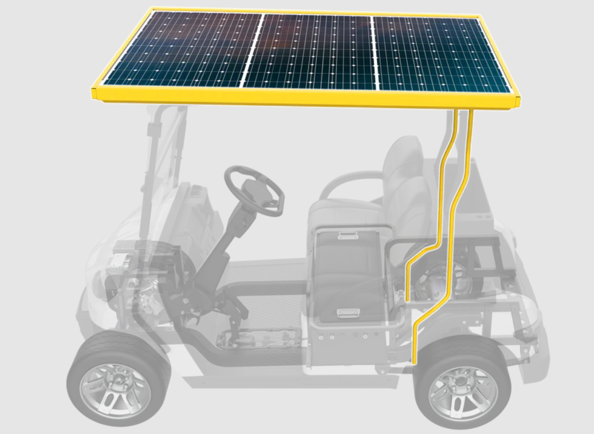
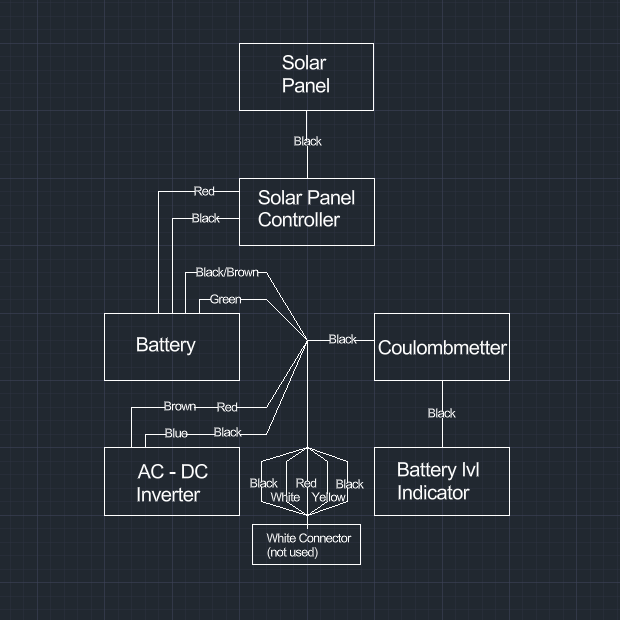
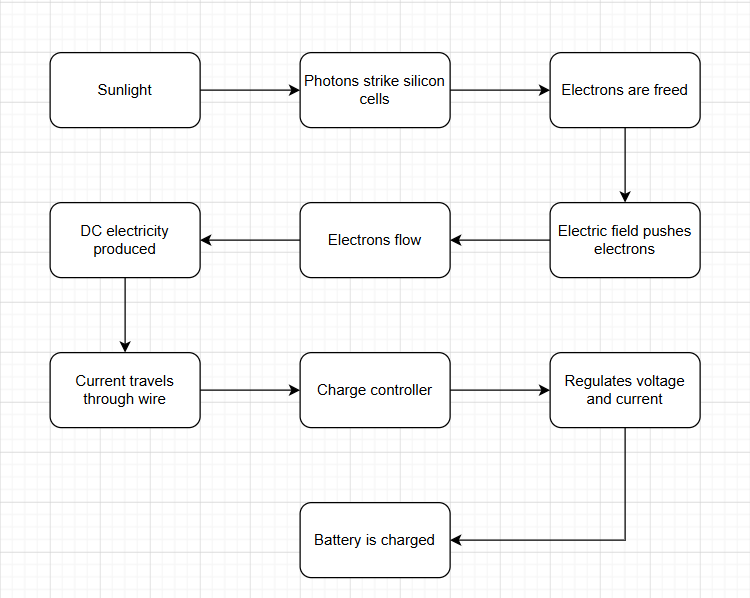

# Detailed Design

This document delineates the objectives of a comprehensive system design. Upon reviewing this design, the reader should have a clear understanding of:

- How the specific subsystem integrates within the broader solution
- The constraints and specifications relevant to the subsystem
- The rationale behind each crucial design decision
- The procedure for constructing the solution

## General Requirements for the Document

The document should include:

- Explanation of the subsystem’s integration within the overall solution
- Detailed specifications and constraints specific to the subsystem
- Synopsis of the suggested solution
- Interfaces to other subsystems
- 3D models of customized mechanical elements*
- A buildable diagram*
- A Printed Circuit Board (PCB) design layout*
- An operational flowchart*
- A comprehensive Bill of Materials (BOM)
- Analysis of crucial design decisions

*Note: These technical documentation elements are mandatory only when relevant to the particular subsystem.

*Note every part of this detailed design is a rough draft
## Function of the Subsystem

The primary function of the solar charging subsystem is to convert solar energy into electrical energy and provide supplemental charging energy to the golf cart's lithium-ion battery. This reduces the amount of energy that must be supplied by an external charging source and may reduce the frequency of grid charging.

## Specifications and Constraints

### Specifications

**Electrical Specifications**

| Parameters                  | Specifications |
|-----------------------------|----------------|
| Rated Power                 | 425-440 W      |
| Maximum Power Voltage (Vmp) | 32.23-32.98 V  |
| Maximum Power Current (Imp) | 13.23-13.36 A  |
| Open Circuit Voltage (Voc)  | 38.29-38.63 V  |
| Short Circuit Current (Isc) |	14.05-14.30 A  |
| Efficiency                  |	21.80-22.57 %  |

**Mechanical Specifications**

| Parameters                n   | Specifications          |
|-------------------------------|-------------------------|
| Panel Diementions (L x W x H) | 1722 x 1134 x 30        |
| Panel weight                  | 20.5 ±1kg               |
| Panel Type                    | N type Mono-crystalline |
| Frame Material                | Anodized Aluminum       |
| Adapter Material              | Undetermind             |
| Number of Mounting Points     | 4                       |

**Environmental Specifications**

| Parameters	        | Specifications                                                       |
|-----------------------|----------------------------------------------------------------------|
| Operating Temperature | -40 to 85 C                                                          |
| Weather Exposure  	| Outdoor                                                              |
| Vibration         	| Must withstand vibration generated during normal golf-cart operation |
| Durability	        | Must withstand hits from objects such as golf balls                  |

### Constraints:

**Solar panel frame connecting to the back two support posts:**

The frame of the solar panel is not designed to fit the Club Cars four vertical supports that hold up the roof. The rear mounting inserts have an outer width of XX mm, while the corresponding Club Car support has an internal width of XX mm, resulting in an interference of XX mm. Although it is possible to fit them into the supports, it is not recommended that this should be the standard.

**Wire connecting to the battery:**

There is no set or direct route for the wiring from the solar panel to the charge controller, so a new path will have to be made.

## Overview of Proposed Solution

The proposed solution to the Solar panel framing constraint, shall be that the team will make some adapter to snugly hold both the frame inserts and the golf car supports to ensure that the frame will not cause unnecessary stress or safety issues on the posts.

The solution for feeding the wiring from the solar panel to the battery shall be that the wire will go from the back of the solar panel into the back post of the golf car and through the side wall of the battery compartment, as shown in Figure 1.1.

**Figure 1.1** [1]

## Interface with Other Subsystems

### Electrical

* Inputs: 
    * Solar irradiance

* Output:
    * DC electrical power to charge controller

* Interface:
    * Solar panel → charge controller 
    * Charge controller → battery/BMS

### Mechanical 

* Interface:
    * Solar-panel frame → four golf-cart support posts
    * Mounting adapters → rear support posts

### Environmental

* Solar radiation 
* Ambient temperature 
* Rain/moisture 
* Wind loading 
* Vibration from golf-cart operation

## 3D Model of Custom Mechanical Components

N/A.

## Buildable Schematic 

**Figure 1.2:**

Figure 1.2 shows the buildable schematic for the wiring of the solar panel subsystem, including the electrical connections between the solar panel, charge controller, battery, and associated monitoring components.

## Printed Circuit Board Layout

N/A.

## Flowchart

**Figure 1.3:**

  

 Figure 1.3 demonstrates the process of coverting sunlight into useful energy for the battery through the solar panel.

## BOM

| Item                | Quantity | Manufaturer | Part #     | Specification                | Source                          |
|---------------------|----------|-------------|------------|------------------------------|---------------------------------|
| Solar panel         |	1        | Lani EV     | Not Listed | "Monocrystaline + 400W"      | Lani EV Solar Roof Retrofit kit |
| Cables & Connectors | 1 set    | Lani EV     | Not Listed | Included with Solar Roof kit | Lani EV Solar Roof Retrofit kit |
| MPPT Controller     | 1        | Lani EV     | Not Listed | Included with Solar Roof kit | Lani EV Solar Roof Retrofit kit |

## Analysis

## Analysis

### Solar Panel Selection

An N-type monocrystalline solar panel was selected for the solar charging subsystem due to its high efficiency and power output relative to its physical size. The supplied panel has a rated power range of 425–440 W and an efficiency range of 21.80–22.57%. The relatively high efficiency is important for this application because the available mounting area is limited by the dimensions of the golf cart. The panel dimensions of 1722 × 1134 × 30 mm allow the panel to be mounted above the golf cart while providing a large surface area for solar energy collection.

### Electrical Analysis

Pmp = Vmp × Imp

Pmp = (32.98 V)(13.36 A)

Pmp = 440.6 W

The electrical specifications of the solar panel were evaluated to verify its rated output. At the upper end of the specified operating range, the panel has a maximum power voltage of 32.98 V and a maximum power current of 13.36 A. Using \(P = VI\), the calculated maximum output power is approximately 440.6 W. This closely agrees with the manufacturer's maximum rated power of 440 W.

### Expected Energy Production

| Time at Rated Output | Theoretical energy generated |
|----------------------|------------------------------|
| 1 hour	           | 0.44 kWh                     |
| 2 hours	           | 0.88 kWh                     |
| 4 hours	           | 1.76 kWh                     |
| 5 hours	           | 2.20 kWh                     |
| 8 hours	           | 3.52 kWh                     |

Under ideal rated conditions, the 440 W panel could theoretically generate 0.44 kWh of electrical energy for each hour of operation at maximum rated power. Actual energy production will be lower and will vary with solar irradiance, panel orientation, temperature, shading, charge-controller efficiency, and other system losses.

### Mechanical Analysis

The dimensions and weight of the solar panel introduce additional mechanical considerations. The panel has a mass of approximately 20.5 kg and is supported at four mounting locations. The existing rear mounting inserts do not properly fit within the rear Club Car support posts. Forcing the inserts into the supports could introduce unnecessary mechanical stress and make the design difficult to reproduce. Therefore, an adapter will be designed to provide a secure interface between the solar-panel frame and the existing rear support posts.

### Design Decisions

| Design Decision              | Rationale                                                                                                   |
|------------------------------|-------------------------------------------------------------------------------------------------------------|
| N-type monocrystalline panel | High efficiency and power output within limited roof area                                                   |
| 425–440 W panel	           | Provides significant supplemental charging capability                                                       |
| MPPT charge controller       | Allows the panel to operate near its maximum-power point while providing controlled charging to the battery |
| Four mounting points         | Uses the existing golf-cart roof-support structure                                                          |
| Rear mounting adapter        | Corrects the dimensional mismatch between the supplied frame and rear supports                              |
| Wiring through rear support  | Provides a route from the roof-mounted panel to the battery compartment while limiting exposed wiring       |

## References

[1] Lani EV, “Upgrade Kits,” *Lani EV*. [Online]. Available: https://www.laniev.com/collections/upgrade-kits?page=1#21723cf73ae83d8746d6b6ebdd6dae5a.
[Accessed: Sep.13, 2026].