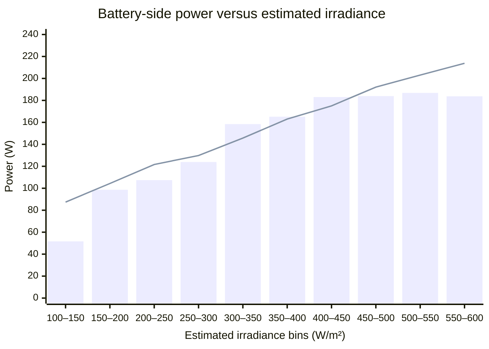

# Project HELIOS Experimental Analysis

**Tennessee Tech University · ECE Capstone Team 6 · LaniEV retrofit**

## Introduction

Project HELIOS is a Tennessee Tech capstone project with LaniEV to retrofit an electric Club Car with a solar roof and a lithium iron phosphate battery. This report examines whether the installation manual gives someone unfamiliar with the kit enough information to complete the retrofit and what the team can verify about the resulting cart.

The report covers the installation manual trials, changes documented in the manual, the roof swap and its effect on weight, electrical checks, fixed-panel charging and driving discharge tests, and simulations of the proposed tracker on the team's Club Car. The fixed-panel measurements provide the baseline for evaluating the solar-tracking concept.

## 1. Installation manual validation

**Purpose and expected result.** Demonstrate that a person who did not write the manual can complete the documented steps with the correct hardware, orientation, routing, and connections. The expected outcome was independent completion with clear component identification and minimal intervention.

Two roof installation trials and two battery wiring trials were timed using the October 24 installation manual. The roof trials used items 1–5. The battery trials used the battery and harness (item 7) and wall-charger connections (item 11). Questions were answered during the trials, and the work was inspected afterward. Skipped or incorrect steps and questions asked by the installers were recorded. In the roof trials, outside participants installed the frame, gaskets, front and rear plates, and panel, and attempted to connect the solar leads. A team member unfamiliar with the battery wiring and an outside participant each attempted the battery wiring procedure.

| Section | Trial | Tester(s) | Time | Skipped or incorrect steps | Questions |
|---|---:|---|---:|---:|---:|
| Solar roof | 1 | Two outside non-authors | 31 min 24 s | 4 | 3 |
| Solar roof | 2 | Two outside non-authors | 30 min 59 s | 3 | 3 |
| Battery wiring | 1 | Team member unfamiliar with battery wiring | 4 min 15 s | 3 | 1 |
| Battery wiring | 2 | One outside non-author | 6 min 30 s | 2 | 2 |

| Section | Trials | Mean time | Sample SD | Range | Mean errors | Mean questions |
|---|---:|---:|---:|---|---:|---:|
| Solar roof | 2 | 31 min 11.5 s | 17.7 s | 30:59–31:24 | 3.5 | 3.0 |
| Battery wiring | 2 | 5 min 22.5 s | 95.5 s | 4:15–6:30 | 2.5 | 1.5 |

### What installers asked and missed

| Trial | Questions | Incorrect or skipped steps |
|---|---|---|
| Roof 1 | Solar lead routing, washer counts, and gasket placement | Misplaced screws, left the positive and negative leads unrouted to the rear, omitted the two front-bolt washers, and placed the gasket on the frame instead of the panel. |
| Roof 2 | Solar lead routing, washer counts, and cover-plate orientation | Omitted the front-bolt washers, positioned the panel too far forward to fit the front plate, and left both solar leads unrouted to the rear. |
| Battery wiring 1 | Asked what an unidentified wire was | Omitted the solar positive, wall-charger negative, and white wall-charger connector. |
| Battery wiring 2 | Asked what two wires were and where each went | Omitted the solar positive and the white charger connection. |

The trials fell short of the expectation of independent, correct completion. The roof testers repeatedly asked about washers and cable routing. Both battery testers omitted the solar positive and the white charger connection. On page 11, installers interpreted steps 1–3 as placing the gasket on the frame crossbars. During testing, carrying out steps 4–5 first and then returning to steps 1–3 resolved the gasket placement issue.

### Confirmation notes and what the manual records

The validation log records issues the testers encountered. The table compares the C01–C10 confirmation items with the installation observations and procedures. The [October 24 manual](https://github.com/alectsnodgrass/Project-HELIOS/blob/main_Snodgrass/2.%20Documentation/5.%20Installation%20Manual/Old%20Drafts/LANI_EV_Retrofit_Installation_Manual_24OCT2026.pdf) provides the earlier procedure. The [November 13 manual](https://github.com/alectsnodgrass/Project-HELIOS/blob/main_Snodgrass/2.%20Documentation/5.%20Installation%20Manual/LANI_EV_Retrofit_Installation_Manual_13NOV2026.pdf) is the latest edition archived in the repository.

| ID | Original confirmation item | What the manual and trials document |
|---|---|---|
| C01 | Vehicle variant, service manual, and kit version | The team checked the manufacturer serial number and VIN and identified the cart as a 2020 Club Car Precedent matching the manual and kit. |
| C02 | Tools, mounting hardware, quantities, and torque | The installation identified the tools and hardware used. The trial record lists 8 mm and 10 mm sockets, a 1 in spade bit, and a T18 star bit. The manual shows the front and rear mounting hardware. |
| C03 | Isolation, existing battery removal, and controller discharge delay | The cart arrived with the lead-acid pack already removed. The trials did not exercise the manual's negative-first disconnect or its provisional 90-second delay. |
| C04 | Rear wheel-well openings and cable protection | The team routed the wires through a 1 in opening in the rear wheel well into the battery bay. The manual describes selecting the opening location based on access to the bay. |
| C05 | Rear support fit and alignment | The rear supports had to spread to align the mounting holes during the first installation. The front supports aligned without adjustment. |
| C06 | Gasket fit, cover screws, and tightening | The team cut the supplied gasket in half for the front and rear of the panel. The trial record lists four cover screws per end. Performing page 11 steps 4–5 before 1–3 worked better during the trial. |
| C07 | Compartment trimming and battery restraint | The team trimmed the compartment so the replacement battery could sit flat. The manual shows the compartment before and after trimming and documents the bracket mounting procedure. |
| C08 | Old port disposition and new port location and routing | The team removed the old charging port and installed the replacement in the same location. |
| C09 | Charger identification, wiring diagram, and connection details | The wires were unlabeled and the separate wiring diagram was unavailable to the trial installers. Both battery trials omitted two of the same connections. The validation log lists a wiring diagram and wire labels as revisions. |
| C10 | Pre-power, charging, fault, and operating checks | The timed manual trials covered the roof swap and battery connection. The final-check section documents separate mechanical and electrical handover checks. |

The panel section includes gasket and cover photographs and separate steps for the front and rear covers and PV lead identification.

## 2. Solar roof installation and mass change

**Purpose and expected result.** Document the roof conversion and quantify its impact on vehicle weight. The added panel, frame, gasket and hardware were expected to increase roof weight.

| Installation stage | Evidence recorded |
|---|---|
| Remove and weigh OEM roof | 19 lb |
| Fit the frame to the original supports | Frame alignment and rear support spread documented in C05 |
| Fit panel, gaskets and end plates | Trials identified sequencing, washer placement and front-plate orientation issues |
| Route and connect panel wiring | Trials identified routing and polarity-label issues |
| Record replacement component weights | LaniEV supplied 40 lb for the frame and 10 lb for the panel |

The removed OEM roof (item 6) weighed **19 lb** on a scale with 1 lb display increments (item 12). The LaniEV frame and panel weights (items 2 and 3) total **50 lb**, an **estimated 31 lb increase** over the OEM roof, consistent with the expected increase. The team did not weigh the complete replacement assembly. Separate weights for the gasket, covers, and fasteners (items 4 and 5) were not recorded.

The original lead-acid bank was missing when the team received the vehicle. The stock battery estimate is 372 lb for six 8 V Werker SLIGC8-875 batteries at about 62 lb each, using the [Batteries Plus listing for the Werker GC8 battery](https://www.batteriesplus.com/productdetails/battery/golf-cart/columbia-par-car/sligc8%3D875). The replacement pack's manufacturer label lists 108.03 lb. The team did not weigh that pack. The resulting battery-only comparison is approximately 264 lb lighter. Applying those component differences to the 909 lb stock weight used in the team's comparison gives an estimated 676 lb, or approximately 680 lb, for the retrofit and a net reduction of approximately 230 lb. The retrofit estimate uses the stock reference, the measured OEM roof weight, and supplied component weights.

The [original cart](https://github.com/alectsnodgrass/Project-HELIOS/blob/main_Snodgrass/2.%20Documentation/1.%20Photos/1.%20Original%20Cart.jpeg) and [empty battery bay](https://github.com/alectsnodgrass/Project-HELIOS/blob/main_Snodgrass/2.%20Documentation/1.%20Photos/2.%20Battery%20Bay.jpeg) show the condition at receipt. The [mounted frame photo](https://github.com/alectsnodgrass/Project-HELIOS/blob/main_Snodgrass/2.%20Documentation/1.%20Photos/5.%20New%20Frame.jpeg) shows the roof supports before the panel was fitted.

## 3. Electrical verification

**Purpose and expected result.** The team expected the terminal labels to correspond to the wiring and the observed operating values to fall within equipment ratings, with no wiring changes needed.

**Procedure.** The electrical checks used the cart, battery and harness, MPPT controller, wall charger, and meter (items 1, 7, 8, 11, and 13). The procedure specified disconnecting devices from the main supply and other devices before checking polarity and continuity. Voltage was recorded at designated device terminals. The 14.50 V MPPT reading was taken at the battery output terminals. The solar input was prewired when supplied, and the panel connection state during that reading was not recorded. Resistance was measured across the corresponding positive and negative terminals of each of the four devices. Wire gauges were compared with published reference ampacities. Terminal voltage and continuity readings were taken with a [UNI-T UT161B multimeter](https://meters.uni-trend.com/product/ut161-series). Harness routing and wire sizes were checked, and battery and charger operating values were read from [Olelon Connect](https://www.olelonenergy.com/wp-content/uploads/2024/08/Olelon-APP-Instruction-Manual.pdf), the battery monitoring app. Its user manual shows where to find voltage, current, and state of charge. Figure 1 shows the electrical layout, including the MPPT-to-battery path used for parked charging measurements.

*Figure 1. Retrofit wiring schematic.*

| Device | Terminal voltage (V) | Resistance across device terminals (Ω) |
|---|---:|---:|
| Traction controller | 0.538 | 0.000 |
| Wall charger | 0.000 | 0.000 |
| Display and power button | 0.000 | 0.000 |
| MPPT controller, battery-side output | 14.50 | 0.000 |

The traction controller and MPPT controller gave positive readings. The charger and display returned zero voltage, so the team consulted LaniEV engineers to confirm terminal identification. The resistance readings describe the path across each device’s terminals. They do not verify individual harness continuity or rule out shorts or chassis faults.

### Conductor sizing

The reference values below come from the [Mid America Wire and Cable MTW chart](https://midamericawirecable.com/resources/mtw-wire-ampacity-chart), which summarizes UL 508A Table 28.1 for industrial control panels.

| Circuit | Wire size or cable marking | Reference ampacity |
|---|---|---:|
| Traction controller | 4 AWG | 70–85 A |
| Charger AC input | 14 AWG | 15 A |
| Charger DC output to battery | 14 AWG × 2C + 20 AWG × 4C | 15 A and 5 A, respectively |
| Display and power button | 16 AWG | 10 A |
| MPPT controller | 14 AWG | 15 A |

The approximately 21 A pack current observed during driving was below the cited range for the 4 AWG controller wiring. The charger’s 12 A maximum AC input rating was below the 15 A reference for the 14 AWG input lead. The charger-to-battery cable has six conductors. The two 14 AWG conductors were identified as the main charging leads. The approximately 21 A DC charging reading exceeds the cited 15 A per-conductor comparison value. The test did not establish the individual functions or currents of the four 20 AWG conductors. The industrial-panel reference does not establish the installed cable assembly’s rating.

| Item | Value or observation |
|---|---|
| Battery voltage | 51.2 V nominal. The highest voltage recorded during the electrical check was 52.60 V. |
| Battery discharge | App readings of approximately 13.4 A under normal load and 18.5 A under a higher load. A separate observation during motion gave an approximate maximum of 21 A. |
| Battery current specifications | The [Olelon 051105 battery datasheet](https://www.olelonenergy.com/wp-content/uploads/2024/09/051105.pdf) lists 30 A recommended and 40 A maximum charging current, and short-duration discharge ratings of 480 A for 3 s and 315 A for 30 s. The short-duration ratings are separate from the operating currents observed in the app. |
| Wall charging | Olelon Connect showed approximately 21 A while charging from a nominal 120 V AC outlet. The observed charging current was below the charger's 25 A output rating and the battery's 30 A recommended and 40 A maximum charging currents. |
| Charger nameplate | Olelon WTL4825ZG AC–DC charger, supplied with the battery. Input: 100–240 V AC, 50/60 Hz, 12 A max. Output: 58.4 V DC, 25 A. Battery type listed: 58.4 V LFP lithium, 100–200 Ah. |
| OEM fuse references | The [Precedent service manual's main-harness schematic](https://github.com/alectsnodgrass/Project-HELIOS/blob/main_Snodgrass/2.%20Documentation/0.%20Project%20Details/Club%20Car%20Manuals/Precedent%20(EX-40%20And%20ERIC)%20Maintenance%20And%20Service%20Manual.pdf) shows a 2 A fuse on the unused extension output and a 15 A fuse on the controller auxiliary supply to the key-switch circuit. The approximately 13.4 A normal-load reading is total pack current. It cannot establish the current in either fused branch. |
| Headlights | The headlights were inoperative, and the cart lacked a 48 V to 12 V DC–DC converter. The brake lights and turn signals were reported unaffected. |

### Wiring standards review

The team compared the installation with [ANSI/OPEI Z130.1-2020, Section 9.1](https://github.com/alectsnodgrass/Project-HELIOS/blob/main_Snodgrass/2.%20Documentation/0.%20Project%20Details/Standards/Safety_Manual_Golf_Cars_ANSIOPEIZ130.1-2020.pdf).

| Clause | Check and finding |
|---|---|
| §9.1.1 Grounding | The wiring inspection documented a battery-negative return. The meter readings above do not establish chassis isolation. |
| §9.1.2 Routing | Before installing the battery and charger, the team inspected the wiring entering and leaving the battery compartment for pinch points and proximity to heat sources. |
| §9.1.3 Capacity | Wire sizes were compared with reference ampacities and the available operating current readings. The controller and charger AC input comparisons were within the cited reference values. The charger DC cable assembly rating and individual fused-branch currents were not verified. |
| §9.1.4 System voltage | The provision calls for guarding against exposure to nominal system voltages above 60 V DC or 30 V AC. The 51.2 V nominal pack and the 52.60 V observed reading describe the DC battery circuit. They do not establish guarding of the AC charger input. |

The positive controller and MPPT readings were consistent with the designated polarity at the points tested. The observed charging current fell within the charger and battery ratings, as expected. The DC charger cable assembly rating, chassis isolation, branch fuse loading, and AC guarding remain inconclusive.

## 4. Solar charging baseline

**Purpose and expected result.** Establish fixed-panel battery-side charging performance before evaluating the parked solar-tracking design. Power was expected to vary with sunlight and system conditions. 

**Procedure.** The team parked the fixed-panel cart on a level concrete slab in the open lot on the north side of Tennessee Tech’s Ashraf Islam Engineering Building along Stadium Drive between University Drive and West 10th Street, with the panel exposed to sunlight. Using items 1–3 and 7–10, it recorded time of day, DC voltage and current at the controller-to-battery connection with a [Fluke 15B+ multimeter](https://www.fluke.com/en-us/product/electrical-testing/digital-multimeters/fluke-15b-plus), plane-of-panel illuminance with a URCERI MT-912, and displayed battery SOC. The illuminance sensor was held parallel to the panel and kept unobstructed. Battery-side power was calculated as $P=VI$. The workbook illuminance entries are in kilolux. The estimated irradiance is $G_{est}=1000L_{klx}/122$ in W/m², using an assumed daylight efficacy of 122 lm/W. Energy was integrated by the trapezoidal rule with the recorded time differences in hours.

**Sampling.** The existing workbook records samples approximately every **25 minutes**. The professor's experimental-analysis guidance recommends **one-minute sampling or faster**. Each matched window has 12 measured samples spanning 11 intervals. Power between readings is estimated by interpolation for integration. Clouds and brief charging transients may be missed. There are no one-minute measurements in these runs.

*Figure 2. MPPT-to-battery measurement location.*

### Results for matched windows

| Date in 2026 | Recorded window | Mean sampled power (W) | Highest sample (W) | Mean estimated irradiance (W/m²) | Energy (Wh) | Displayed SOC | Estimated insolation (kWh/m²) | Normalized yield (Wh per equivalent peak-sun hour) |
|---|---|---:|---:|---:|---:|---|---:|---:|
| Oct. 9 | 10:45–15:20 | 145.32 | 202.37 | 330.9 | 681.9 | 6% → 16% | 1.564 | 436.1 |
| Nov. 3 | 09:20–13:55 | 138.48 | 192.75 | 350.8 | 648.8 | 17% → 24% | 1.641 | 395.4 |
| Nov. 7 | 08:35–13:10 | 181.99 | 205.35 | 402.7 | 851.7 | 24% → 35% | 1.872 | 455.0 |
| Nov. 8 | 09:15–13:50 | 165.27 | 179.62 | 424.7 | 763.2 | 34% → 45% | 1.977 | 386.0 |
| Nov. 15 | 08:35–13:10 | 179.10 | 202.13 | 360.5 | 832.3 | 45% → 57% | 1.682 | 494.8 |

Energy averaged **755.6 Wh per 4 h 35 min window** with a sample SD of **89.5 Wh** across the five dates. The Nov. 8 workbook integration gives 763.249 Wh and rounds to 763.2 Wh, matching the five-run figure. The full Nov. 8 record includes the 14:15 observation (53.2 V, 2.14 A, 40.6 klx, 46% SOC). Over that 5 h record, the reported values are 161.31 W mean, 179.62 W peak, 417.6 W/m² mean estimated irradiance, and 814.1 Wh estimated energy. The 14:15 observation remains in the workbook and is excluded from the five matched windows and their plots.

The [charging workbook](https://github.com/alectsnodgrass/Project-HELIOS/blob/main_Snodgrass/2.%20Documentation/2.%20Electrical/Charging%20Analysis/Charging%20Analysis%20Data.xlsx) contains the original timestamps and readings used in the tables. The [five-run charging analysis](https://github.com/alectsnodgrass/Project-HELIOS/blob/main_Snodgrass/2.%20Documentation/2.%20Electrical/Charging%20Analysis/Charging_Analysis.md) documents the measurement setup and matched-window selection.

*Figure 3. Power versus time, five matched-duration runs.*

*Figure 4. Mean power by date, five matched-duration runs.*

*Figure 5. Integrated energy by date, five matched-duration runs.*

*Figure 6. Displayed battery SOC versus elapsed time, five matched-duration runs.*

### Irradiance normalization and residuals

Estimated insolation integrates $G_{est}$ over the same window as the power. Dividing insolation by 1 kW/m² yields equivalent peak-sun hours. The normalized yield divides battery-side Wh by those hours. This comparison inherits uncertainty from the uncalibrated lux conversion and uses the recorded window only.

An ordinary least-squares fit to the 60 matched-window workbook samples gives $P_{fit}=54.68+0.28710G_{est}$, with $P$ in watts and $G_{est}$ in W/m². The fit has $R^2=0.686$ and an in-sample residual RMSE of 18.88 W. Residuals are observed power minus fitted power. The nonzero intercept is descriptive over the sampled range of 114–554 W/m². It has no demonstrated predictive value at zero irradiance.

*Figure 7. Bars show the mean measured power in each 50 W/m² bin. The line evaluates the 60-sample fit at each bin's mean irradiance. Bin counts from left to right are 1, 3, 2, 6, 8, 11, 18, 5, 5 and 1.*

| Date | Mean residual (W) | Range of residuals (W) |
|---|---:|---:|
| Oct. 9 | −4.36 | −15.85 to +9.50 |
| Nov. 3 | −16.92 | −35.75 to +7.15 |
| Nov. 7 | +11.71 | −20.12 to +31.78 |
| Nov. 8 | −11.34 | −30.07 to +22.46 |
| Nov. 15 | +20.91 | +8.29 to +34.51 |

Power generally increased with estimated irradiance, consistent with the expected response to sunlight. The shifts by date show that estimated irradiance alone leaves systematic differences between runs. Starting SOC, panel temperature, exposure and operating conditions vary across dates. The workbook's calculated efficiency column also depends on the irradiance estimate and does not establish measured panel efficiency.  The five-run SD captures between-window variation only.

## 5. Driving discharge

The driving tests compared how far the cart traveled for a 10-percentage-point drop in displayed battery state of charge (SOC) at two loads, with the original fixed panel connected and disconnected. The team expected the heavier load to shorten the distance and the connected panel to extend it for the same drop in displayed charge.

### Test procedure and calculations

The team drove the same Tennessee Tech loop around the tennis courts near Stadium Drive and University Drive on November 21 and 22, 2026. From University Drive, the route turned left past the library toward the football stadium, turned left through the parking lot, and turned left again toward University Drive. The tests used the cart, fixed panel, and battery (items 1, 3, and 7). Each lap was approximately 616 yd (0.35 mi). The approximately 260 lb load was tested on November 21, and the approximately 515 lb load on November 22. The team made three runs for each load and panel connection condition. Elapsed driving time was recorded with a stopwatch (item 14), along with completed laps. Starting and ending SOC were read from the circular battery power button and percentage display connected directly to the pack (item 7). Every run ended after a 10-percentage-point decrease in displayed SOC. The reported top speeds were 21 mph at the lighter load and 18 mph at the heavier load. The route stayed fixed, and the driver used full throttle where practical to keep the throttle input consistent. Speed varied with operating conditions and was calculated from distance and elapsed time. The lighter load was one person with belongings and the heavier load was two people with belongings. Each load and panel combination covered 30 percentage points of displayed SOC across three intervals.

The 51.2 V, 105 Ah LiFePO₄ pack has a nominal energy of 5,376 Wh. Distance was calculated from lap count and loop length, and average speed from distance and elapsed time. The calculation treats the displayed SOC decrease as proportional to nominal pack energy, giving 537.6 Wh of estimated net battery energy decrease for each run. Dividing that estimate by run distance gives Wh/mi.

The [discharge workbook](https://github.com/alectsnodgrass/Project-HELIOS/blob/main_Snodgrass/2.%20Documentation/2.%20Electrical/Discharging%20Analysis/Discharge%20Analysis.xlsx) contains the recorded run data. The [discharge analysis](https://github.com/alectsnodgrass/Project-HELIOS/blob/main_Snodgrass/2.%20Documentation/2.%20Electrical/Discharging%20Analysis/Discharging_Analysis.md) documents the calculation from laps and displayed SOC.

### Run results

| Run | Date | Load | Panel | Start SOC | End SOC | Time (min:s) | Laps | Distance (mi) | Mean speed (mph) | Est. net Wh/mi |
|---:|---|---|---|---:|---:|---:|---:|---:|---:|---:|
| 1 | Nov 21 | ~260 lb | Connected | 80% | 70% | 19:13 | 13 | 4.550 | 14.21 | 118.2 |
| 2 | Nov 21 | ~260 lb | Disconnected | 70% | 60% | 18:31 | 12.5 | 4.375 | 14.18 | 122.9 |
| 3 | Nov 21 | ~260 lb | Connected | 60% | 50% | 18:36 | 13 | 4.550 | 14.68 | 118.2 |
| 4 | Nov 21 | ~260 lb | Connected | 50% | 40% | 18:26 | 13 | 4.550 | 14.81 | 118.2 |
| 5 | Nov 21 | ~260 lb | Disconnected | 40% | 30% | 16:38 | 12 | 4.200 | 15.15 | 128.0 |
| 6 | Nov 21 | ~260 lb | Disconnected | 30% | 20% | 16:45 | 12 | 4.200 | 15.04 | 128.0 |
| 7 | Nov 22 | ~515 lb | Disconnected | 65% | 55% | 12:38 | 9 | 3.150 | 14.96 | 170.7 |
| 8 | Nov 22 | ~515 lb | Disconnected | 55% | 45% | 12:15 | 9.5 | 3.325 | 16.29 | 161.7 |
| 9 | Nov 22 | ~515 lb | Disconnected | 45% | 35% | 13:34 | 10 | 3.500 | 15.48 | 153.6 |
| 10 | Nov 22 | ~515 lb | Connected | 80% | 70% | 13:50 | 11 | 3.850 | 16.70 | 139.6 |
| 11 | Nov 22 | ~515 lb | Connected | 70% | 60% | 14:25 | 11.5 | 4.025 | 16.75 | 133.6 |
| 12 | Nov 22 | ~515 lb | Connected | 60% | 50% | 14:33 | 11.5 | 4.025 | 16.60 | 133.6 |

| Load | Panel | Runs | Mean distance (mi) | Mean speed (mph) | Mean est. net Wh/mi | Sample SD (Wh/mi) |
|---|---|---:|---:|---:|---:|---:|
| ~260 lb | Connected | 3 | 4.550 | 14.56 | 118.2 | 0.0 |
| ~260 lb | Disconnected | 3 | 4.258 | 14.79 | 126.3 | 3.0 |
| ~515 lb | Connected | 3 | 3.967 | 16.68 | 135.6 | 3.5 |
| ~515 lb | Disconnected | 3 | 3.325 | 15.58 | 162.0 | 8.5 |

The cart traveled about 7% farther with the panel connected at the lighter load and about 19% farther at the heavier load for the same displayed SOC drop. Mean estimated net battery energy use ranged from 118.2 to 162.0 Wh/mi. The 0.0 Wh/mi sample SD for the lighter connected condition reflects three identical lap counts at the same indicated SOC drop. The SOC-to-energy estimate and approximate route length still contribute uncertainty.

The condition means followed both expectations. The heavier load traveled less far at both panel settings, and the connected panel was associated with longer runs at both loads. Starting SOC and average speed varied between runs, and the two loads were tested on separate days. Because the team did not meter the solar and traction branches separately during driving, the estimated Wh/mi describes the net battery decrease and cannot isolate how much energy the panel supplied to the cart.

### Charging and discharge comparison

The parked 4 h 35 min charging windows delivered an estimated **648.8–851.7 Wh** at the MPPT output toward the battery. The driving runs each represented **537.6 Wh** of estimated net battery decrease based on nominal capacity and displayed SOC. One value describes electrical input at the controller output and the other estimates the change in stored battery energy. The two figures show the scale of the measured charging and estimated discharge without establishing how many driving miles a parked charge would replace.

*Figure 8. Distance per 10-point decrease in displayed SOC.*

*Figure 9. Mean of the run-average speeds by condition.*

*Figure 10. Estimated net battery energy decrease per mile.*

*Figure 11. Starting and ending displayed SOC for all 12 runs.*

## 6. Solar-tracking simulation

The simulation tested whether the panel would tilt toward the strongest light and stop at the modeled tilt limit for inputs beyond its range. The tracking controller reads four light sensors separated by an X-shaped shade divider. Uneven shading produces normalized north–south and west–east errors. The controller uses those differences to command two axes of tilt. Figure 12 shows when the controller commands motion and when the low-light threshold or deadband keeps both motors stopped.

*Figure 12. Solar-tracker controller logic.*

The MATLAB v2.2 files model a 48 × 68 in panel, a 12 in level frame gap, and ±8° independent pitch and roll. The model applies simulated shading to the four sensors and feeds those readings into the controller. The modeled actuator movements then change the panel angle and generate new sensor readings. In the modeled geometry, the required pin-to-pin ranges are **7.22–16.71 in north** and **8.60–15.32 in west**. Those are geometric results for the specified mounts. The modeled drives are hypothetical. The 16.5 in retracted actuator considered earlier is too long for the 12 in neutral mounting gap in this arrangement.

The team ran the MATLAB demonstration with several simulated sun directions. For inputs within range, the actuators moved the panel toward the stronger light. More extreme inputs drove the model to its tilt limit. Both responses matched expectations. The demonstration can be opened with `x_sensor_tracker_demo`.

The [MATLAB v2.2 setup notes](https://github.com/alectsnodgrass/Project-HELIOS/blob/main_Snodgrass/2.%20Documentation/3.%20Software/Solar_Tracker/MATLAB%20Files/START_HERE.txt) document the assumed geometry. The [verification script](https://github.com/alectsnodgrass/Project-HELIOS/blob/main_Snodgrass/2.%20Documentation/3.%20Software/Solar_Tracker/MATLAB%20Files/verify_x_sensor_tracker.m) checks actuator travel across the modeled tilt range.

The Tinkercad circuit simulation modeled an Arduino Uno R3 and four light sensors (item 15). The [Tinkercad project page in the repository](https://github.com/alectsnodgrass/Project-HELIOS/blob/main_Snodgrass/2.%20Documentation/3.%20Software/Solar_Tracker/tinkercad.md) provides the circuit share link for inspecting the sensor inputs and controller wiring. The actuator travel values above come from the MATLAB geometry. The charging tests in Section 4 used the original fixed panel.

## 7. Overall findings

The supplied frame and panel weights imply a 31 lb increase over the measured OEM roof weight. The manual trials showed where installers needed clearer instructions, especially for front-bolt washers, solar lead routing, and wire identification. The fixed panel delivered an estimated 648.8–851.7 Wh toward the battery over the five matched charging windows. In the 12 driving runs, the cart traveled farther with the panel connected at both tested loads for the same indicated SOC decrease. The simulations describe how the proposed tracker would respond to sensor readings and what actuator travel the modeled geometry requires.

## 8. Component inventory

The inventory below covers the equipment identified in the installation trials, roof weighing, and fixed-panel charging and driving discharge tests.

| Item # | Description | Quantity | Vendor/source | Order # / ID | Cost | Storage location | Date acquired | Condition | Notes |
|---:|---|---|---|---|---|---|---|---|---|
| 1 | 2020 Club Car Precedent electric | 1 | Tennessee Tech University | — | — | — | — | — | Cart under test |
| 2 | Roof frame | 1 assembly | LaniEV | — | — | — | — | — | Roof trials and fixed-panel test |
| 3 | Roof solar panel | 1 | LaniEV | — | — | — | — | — | Roof trials and fixed-panel test |
| 4 | Gasket material and front/rear plates | 1 gasket set, 2 plates | — | — | — | — | — | — | Roof trials |
| 5 | Roof bolts, washers and cover screws | — | — | — | — | — | — | — | Eight cover screws recorded |
| 6 | Removed OEM roof | 1 | Original Club Car | — | — | — | — | — | Weighed after removal |
| 7 | LiFePO₄ battery system and kit harness | 1 system | LaniEV kit | — | — | — | — | — | Battery wiring, charging baseline, and driving discharge |
| 8 | MPPT charge controller | 1 | LaniEV | — | — | — | — | — | Charging baseline |
| 9 | Digital multimeter | 1 | Fluke | 15B+ model | — | — | — | — | Battery-side voltage and current |
| 10 | Illuminance meter | 1 | URCERI | MT-912 model | — | — | — | — | Plane-of-panel illuminance |
| 11 | AC–DC charger and charging port | 1 each | Charger supplied with the Olelon battery | WTL4825ZG (charger model) | — | — | — | — | Battery wiring trials and electrical checks. The AC lead is 14 AWG. The DC cable is marked 14 AWG × 2C + 20 AWG × 4C. OEM fuse ratings are shown in the service schematic. The cart lacked a 48 V to 12 V DC–DC converter. |
| 12 | Scale | 1 | — | — | — | — | — | — | 1 lb resolution recorded |
| 13 | Digital multimeter | 1 | UNI-T | UT161B model | — | — | — | — | Electrical terminal voltage and continuity checks |
| 14 | Stopwatch | 1 | — | — | — | — | — | — | Driving test time |
| 15 | Virtual Arduino Uno R3 and light sensors | 1 controller, 4 sensors | Tinkercad | — | — | — | — | Virtual | Tracker circuit simulation |

## 9. Individual statements of contributions

**Alec Snodgrass.** Alec directed the team's work and reviewed and revised the material each team member submitted. He edited the installation manual, transforming the content from lab notes to a workable, professional document. Alec led the structural frame design and compiled the team's experimental analysis report. He synthesized the installation trials, electrical checks, charging and discharge analyses, and tracker simulations into the experimental report.

**Parker Branson.** Parker organized and timed the roof and battery wiring trials and recorded the installers' questions and errors by step. He documented how the gasket installation sequence played out and used the trial observations to build the revision log and address the confirmation items. He documented the roof swap and compared the original and retrofit configurations using the measured OEM roof weight and LaniEV’s frame and panel weights, the replacement battery label, and a reference weight for the original lead-acid bank.

**George Vaporis.** George led development of the four-sensor solar-tracking concept and documented the controller flowchart and MATLAB and Tinkercad simulations. He helped validate the installation manual, oversaw the battery wiring trials, and shared the charging data collection. He designed the driving discharge experiment, set the route and throttle procedure, and took most of the driving measurements.

**Nathan Galloway.** Nathan shared the fixed-panel charging data collection and compiled the driving discharge workbook. He analyzed the 12 runs by load and panel connection, calculated distance, average speed, and estimated net battery energy use per mile, and prepared the comparison figures.

**Landon Paul.** Landon recorded terminal voltage and continuity readings, checked harness routing and wire sizes, and documented battery and charger operation using Olelon Connect. He compared the recorded values with equipment ratings and reviewed the installation against the wiring provisions of ANSI/OPEI Z130.1-2020.
